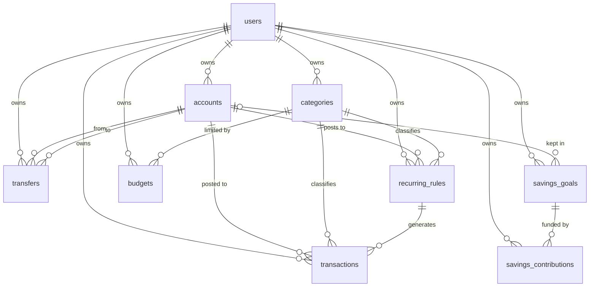

# Database

PostgreSQL 16, managed with Prisma Migrate. Source of truth: `prisma/schema.prisma` plus hand-written constraints at the end of each migration (`prisma/migrations/*/migration.sql`).

The business rules this schema implements are in [PRD §6 Financial rules](PRD.md#6-financial-rules). Status: migrations `…_init`, `…_auth` and `…_accounts_categories` are applied to the development, test and e2e databases; no production data exists, so the schema can still change freely. The app connects with a least-privilege role (SECURITY.md §8); migrations run as the owner via `MIGRATION_DATABASE_URL`. Planned changes are listed in §8.

## 1. Entity relationships



| Table | Purpose |
|---|---|
| `users` | Identity, argon2id password hash, session version (revocation), password-changed timestamp, preferences (base currency, timezone, KHR/USD rate). |
| `accounts` | Cash / bank / digital wallet / other. One currency, fixed. Opening balance. Active or archived (`is_archived` + `archived_at`). |
| `categories` | Income or expense label, per user; colour token; active or archived (`is_archived` + `archived_at`). |
| `transactions` | Income or expense on one account with one category. |
| `transfers` | Movement between two of the user's accounts; two amounts for cross-currency. |
| `recurring_rules` | Schedule template for income/expense. |
| `budgets` | Monthly limit per expense category per currency. |
| `savings_goals` | Target amount, optional date and account. |
| `savings_contributions` | Positive (set aside) or negative (withdraw) earmarks for a goal. |
| `password_reset_tokens` | SHA-256 hash of a single-use reset token, expiry; cascade-deleted with the user. |
| `auth_rate_limits` | Fixed-window counters keyed by SHA-256 of `scope:email-or-ip`; no personal data. |

Prisma model names: `User`, `FinancialAccount` (named to avoid clashing with Auth.js's conventional `Account` model), `Category`, `Transaction`, `Transfer`, `RecurringRule`, `Budget`, `SavingsGoal`, `SavingsContribution`. Tables and columns are `snake_case` via `@@map`/`@map`.

Primary keys are UUIDv7 (`uuid(7)`): unguessable in URLs, time-ordered for index locality.

## 2. Money

- Stored as `BIGINT` minor units in columns suffixed `_minor`.
- Exponent per currency (application constant, `src/lib/money.ts`): **USD = 2**, **KHR = 0**.
- Income/expense/transfer amounts are always **positive**; direction comes from the type or the from/to columns.
- Opening balances may be negative; contributions may be negative (withdrawal) but not zero.
- Maximum single value: 999,999,999,999,999 minor units (fits `BIGINT` and is below `Number.MAX_SAFE_INTEGER`).
- Currency lives on `accounts`, `budgets` and `savings_goals`. A transaction's currency is its account's currency; account currency cannot change, so history stays consistent.
- `users.exchange_rate_khr_per_usd` is `DECIMAL(12,4)` and only used for clearly-labelled approximate combined totals.

## 3. Dates and time

| Kind | Type | Meaning |
|---|---|---|
| `occurred_on`, `start_on`, `end_on`, `month`, `target_date`, `recurrence_date`, `next_occurrence_on` | `DATE` | Calendar day in the user's timezone. No time, no offset. |
| `created_at`, `updated_at` | `TIMESTAMPTZ(3)` | Audit instants, UTC. |

Prisma returns `DATE` as a JS `Date` at 00:00 UTC; convert only via `isoDateToDb` / `dbDateToIso` (`src/lib/dates.ts`). "Today" and "this month" are computed with `todayInTimeZone(users.timezone)` (default `Asia/Phnom_Penh`). `budgets.month` is always the first day of the month.

## 4. Derived balance

```
balance(account) = opening_balance_minor
                 + Σ transactions.amount_minor  WHERE type = 'INCOME'
                 − Σ transactions.amount_minor  WHERE type = 'EXPENSE'
                 − Σ transfers.from_amount_minor WHERE from_account_id = account
                 + Σ transfers.to_amount_minor   WHERE to_account_id   = account
```

Computed in SQL. Dashboard and report totals use the same repository queries so they reconcile with lists by construction; integration tests assert it.

## 5. Integrity constraints

### Ownership (composite foreign keys)

Parents expose `UNIQUE (id, user_id)`; children reference `(parent_id, user_id)`. A row can therefore only point at parents owned by the **same** user.

| Child | References |
|---|---|
| `transactions` | `accounts (id, user_id)`, `categories (id, user_id, type)`, `recurring_rules (id, user_id)` |
| `transfers` | `accounts (id, user_id)` twice (from, to) |
| `recurring_rules` | `accounts (id, user_id)`, `categories (id, user_id, type)` |
| `budgets` | `categories (id, user_id, type)` via `category_type` fixed to `'EXPENSE'` |
| `savings_goals` | `accounts (id, user_id)` (nullable) |
| `savings_contributions` | `savings_goals (id, user_id)` |

Including `type` in the category key guarantees an expense can only use an expense category, and blocks changing a category's type once it is used (`ON UPDATE NO ACTION`).

### Delete behaviour

- Deleting a **user** cascades to all their data.
- **Accounts** and **categories** referenced by transactions, transfers, rules (or, for categories, budgets) cannot be deleted (`NO ACTION`); the service refuses with an explanation and the UI offers archiving instead.

### Archiving with history (Phase 3)

| | Account | Category |
|---|---|---|
| Allowed when | Current **and** projected balance are zero (PRD Q-10), so totals never hide money | Always |
| Past records | Unchanged; still shown on the account page and in reports | Unchanged; still show the category name, marked "(archived)" |
| New records | Blocked (`getUsableAccount` → "This account is archived") | Blocked (`assertCategoryUsable`); not offered in pickers |
| Totals | Excluded from per-currency totals | — |
| Restore | Any time, unless another account now has the same name | Any time |
| Delete | Only with no transactions, transfers, recurring rules or savings goals | Only with no transactions, recurring rules or budgets |
- Deleting a **category** deletes its budgets; deleting a **goal** deletes its contributions.
- Deleting a **recurring rule**: the FK from `transactions` is `NO ACTION`, so the service first detaches created transactions (sets `recurring_rule_id` and `recurrence_date` to NULL) and then deletes the rule, in one transaction (PRD §6.6).

### CHECK constraints (hand-written SQL in the migration)

| Constraint | Rule |
|---|---|
| `users_email_lowercase_chk` | email is stored lower-cased and trimmed |
| `users_exchange_rate_positive_chk` | rate > 0 (column reserved for Q-2; not used or editable) |
| `users_default_alert_threshold_range_chk` | default warning level for new budgets between 1 and 100 % |
| `*_name_not_blank_chk` | names are not blank (accounts, categories, goals) |
| `transactions_amount_positive_chk` | amount > 0 |
| `transactions_recurrence_pair_chk` | rule id and recurrence date are both set or both NULL |
| `transfers_amounts_positive_chk` | both amounts > 0 |
| `transfers_distinct_accounts_chk` | from ≠ to |
| `recurring_rules_amount_positive_chk` | amount > 0 |
| `recurring_rules_interval_range_chk` | 1 ≤ interval ≤ 365 |
| `recurring_rules_end_after_start_chk` | end ≥ start |
| `budgets_amount_positive_chk` | amount > 0 |
| `budgets_expense_only_chk` | category_type = EXPENSE |
| `budgets_month_first_day_chk` | month is the 1st |
| `budgets_amount_max_chk` | limit ≤ 999,999,999,999,999 minor units |
| `budgets_alert_threshold_range_chk` / `budget_alerts_threshold_range_chk` | thresholds 1–100 % |
| `budget_alerts_spent_positive_chk` | spent at warning time > 0 |
| `recurring_rules_completed_chk` | `status = COMPLETED` exactly when `next_occurrence_on` is NULL |
| `recurring_rules_pause_reason_chk` / `recurring_rules_paused_at_chk` | pause reason and time set exactly when PAUSED |
| `recurring_rules_next_in_range_chk` | next date within [start, end] |
| `recurring_rules_name_not_blank_chk`, `recurring_rules_amount_max_chk` | name not blank; amount ≤ max |
| `recurring_runs_reason_required_chk` / `recurring_runs_posted_has_no_reason_chk` | FAILED/SKIPPED rows carry a reason code; POSTED rows none |
| `savings_goals_target_max_chk`, `savings_goals_archived_consistent_chk` | target ≤ max; `is_archived` exactly when `archived_at` is set |
| `savings_contributions_amount_range_chk` | contribution within ±max (and ≠ 0 by the earlier CHECK) |
| `savings_goals_target_positive_chk` | target > 0 |
| `savings_contributions_amount_nonzero_chk` | amount ≠ 0 |
| `users_session_version_nonnegative_chk` | session_version ≥ 0 |
| `password_reset_tokens_hash_format_chk` | token_hash is 64 lowercase hex characters (a SHA-256, never a raw token) |
| `auth_rate_limits_key_format_chk` | key is a SHA-256 hex digest (no raw email/IP) |
| `auth_rate_limits_count_positive_chk` | count > 0 |
| `accounts_archived_consistent_chk` / `categories_archived_consistent_chk` | `is_archived` is true exactly when `archived_at` is set |
| `accounts_opening_balance_range_chk` | opening balance within ±999,999,999,999,999 minor units |
| `categories_color_token_chk` | colour is NULL or one of `chart-1` … `chart-6` |
| `transactions_amount_max_chk` / `transfers_amount_max_chk` | amounts ≤ 999,999,999,999,999 minor units |
| `transfers_same_amount_chk` | amount sent = amount received (v1: same-currency transfers only; drop for FX transfers) |
| `transfers_not_self_reversal_chk` | a transfer cannot reverse itself |

Rules the database cannot express cheaply are enforced in services and covered by integration tests: both accounts of a transfer use the same currency; records of archived accounts are not changed; dates fall between 2000-01-01 and one year after today; account currency is immutable; account names are unique per user ignoring case and extra spaces (the database unique index is case-sensitive; names are normalised in the service); category names likewise per user and type; budget currency matches the user's accounts in use. Name length is capped by the column types (`VARCHAR(60)` accounts, `VARCHAR(40)` categories).

### Uniqueness

`users.email`; `accounts (user_id, name)`; `categories (user_id, type, name)`; `savings_goals (user_id, name)`; `budgets (user_id, category_id, month, currency)`; `transactions (recurring_rule_id, recurrence_date)` — the duplicate-occurrence guard; `transactions (user_id, client_request_id)` and `transfers (user_id, client_request_id)` — one record per form submission (NULLs allowed for seed/recurring rows); `transfers (reverses_transfer_id, user_id)` — each transfer reversed at most once (with a composite FK to the original, same owner).

### Recurring execution (Phase 7)

`recurring_runs` holds one row per (rule, occurrence date) — the execution history; retries update the same row (`attempts`, `last_attempt_at`). Posting relies on the original `transactions (recurring_rule_id, recurrence_date)` unique index plus `FOR UPDATE SKIP LOCKED` on the rule row; see docs/OPERATIONS.md. The due-rule query uses `recurring_rules (status, next_occurrence_on)`.

### Budget warnings (Phase 6)

`budget_alerts` stores one row per (budget, threshold). The unique index makes a duplicate warning impossible even when several expenses are saved at once; evaluation of one budget is serialised with a transaction-scoped advisory lock (`pg_advisory_xact_lock(hashtextextended(budget_id))`), recomputes spent from committed records, inserts with `ON CONFLICT DO NOTHING`/re-activation, and marks rows resolved when no longer reached.

### Concurrency (Phase 4)

Ledger writes run in one transaction that locks the accounts they touch with `SELECT … FOR SHARE` (sorted by id, so writers never deadlock each other) and re-checks the rules against the locked rows. Archiving or deleting an account locks it `FOR UPDATE` and computes the balance / reference count inside that transaction, so it waits for in-flight writes and later writes see the archived flag. Edits lock the record `FOR UPDATE` and compare `updated_at` with the version the user loaded (stale → conflict). Reversal locks the original transfer, so two concurrent reversals cannot both succeed.

## 6. Indexes

| Index | Serves |
|---|---|
| `transactions (user_id, occurred_on DESC, type, account_id, category_id, amount_minor)` — `transactions_user_date_covering_idx` (Phase 5) | ledger date order and date-range filters; dashboard cash flow, category and trend sums as index-only scans (measured on 400k rows: 13.6 → 3.0 ms for a year) |
| `transactions (account_id, occurred_on)` | account balance and account history |
| `transactions (user_id, category_id, occurred_on)` | budget spent, category reports |
| `transfers (user_id, occurred_on DESC)`, `(from_account_id, occurred_on)`, `(to_account_id, occurred_on)` | activity list, balances |
| `recurring_rules (is_active, next_occurrence_on)` | finding due rules |
| `budgets (user_id, month)` | month view |
| `budget_alerts (user_id, read_at, created_at DESC)` | header bell: unread count and newest warnings |
| `accounts (user_id, is_archived)` | active/archived account lists |
| `categories (user_id, type, is_archived)` | category pickers by type |
| `savings_contributions (goal_id, occurred_on)` | goal progress |

Revisit with `EXPLAIN ANALYZE` once realistic seed data exists (Phase 10).

## 7. Migration workflow

```bash
npm run db:migrate -- --name <change>   # create + apply in dev (prisma migrate dev, as the owner role)
npm run db:generate                      # regenerate client (also runs on npm install)
npm run db:deploy                        # apply pending migrations (CI / production)
```

- To add CHECK constraints or other SQL Prisma cannot express: `npx prisma migrate dev --create-only --name <change>`, append SQL to the generated file, then `npm run db:migrate`. Record every hand-written constraint in §5 and cover it in `tests/integration/schema-constraints.test.ts`.
- Never edit a migration that has been applied anywhere shared. Write a new one.
- The integration test run applies migrations to `TEST_DATABASE_URL` automatically.
- The comment in the initial migration still says `DATABASE.md` (written before docs moved to `docs/`). Applied migrations are never edited, because Prisma checksums them.

## 8. Planned schema changes

| Phase | Change | Reason | Depends on |
|---|---|---|---|
| 2 ✔ | `auth_rate_limits`, `password_reset_tokens`, `users.password_changed_at` (migration `…_auth`) | Rate limiting, password recovery, credential audit | — |
| 2 ✔ | Default categories created with every new user (data, not schema) | PRD §5.3 | — |
| 4 ✔ | `payee`, `note` (renamed from `description`), `client_request_id`, `reverses_transfer_id` + constraints (migration `…_transactions_ledger`) | Ledger, idempotency, reversals | — |
| 8 ✔ | `savings_goals`: `name` VARCHAR(60), `note`, `archived_at`, index `(user_id, is_archived)`; `savings_contributions`: `note` VARCHAR(200), `client_request_id` unique per user (migration `…_savings_goals`) | Earmark goals (Q-7 A), idempotent contributions | Q-7 |
| 7 ✔ | `recurring_rules`: `name`, `status` (ACTIVE/PAUSED/COMPLETED, replaces `is_active`), `pause_reason`, `paused_at`, `payee`; new `recurring_runs` table; consistency CHECKs (migration `…_recurring`) | Recurring engine, history, states | Q-4, Q-5 |
| 6 ✔ | `budgets.alert_threshold_percent`, `budgets.archived_at`, `budgets (id, user_id)` unique; new `budget_alerts` table (unique `(budget_id, threshold_percent)`, composite FK to the budget's owner, cascade delete) (migration `…_budgets`) | Configurable warnings without duplicates; archive | — |
| 5 ✔ | Covering index `transactions_user_date_covering_idx` replaces `(user_id, occurred_on DESC)` (migration `…_dashboard_covering_index`) | Index-only dashboard aggregations | — |
| 10 ✔ | `users`: `date_format`, `number_format`, `currency_display`, `budget_alert_mode` (enums), `default_alert_threshold` + CHECK (migration `…_user_preferences`); `_prisma_migrations` revoked from the runtime role (migration `…_restrict_migration_history`) | Display and notification preferences (PRD §6.13); least privilege on hosted databases | — |
| later | `categories.kind` enum (`STANDARD`, `ADJUSTMENT`, `REFUND`) or `exclude_from_reports BOOLEAN` | Balance adjustments / refunds treatment | Q-3, Q-9 |
| later | Drop `transfers_same_amount_chk` | Cross-currency transfers | — |
| 7 | `recurring_rules.paused_at DATE` (nullable) | Skip occurrences missed while paused | Q-4, Q-5 |
| 7 | `transactions.status` (`POSTED`, `PENDING`) | Only if recurring entries require confirmation | Q-4 |
| 8 | None expected for the earmark model; a different model would change `savings_contributions` | — | Q-7 |
| 11 | `EXPLAIN ANALYZE` review of indexes with seeded data (10k+ records per user) | Performance target (PRD §7) | — |

Any change here that touches money, dates or ownership must update PRD §6, this document, and the constraint tests in the same change.
